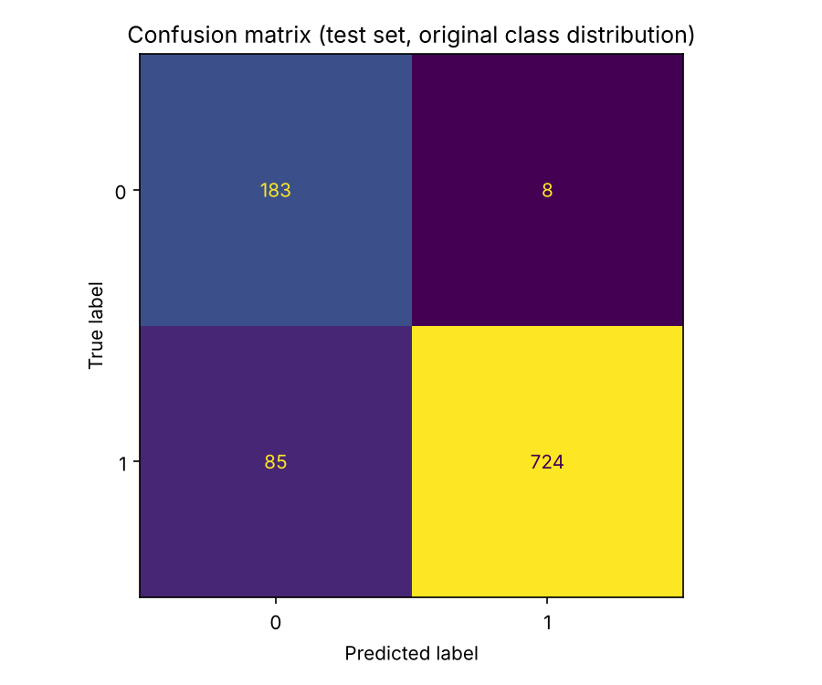

# k-NN Classification of Schizophrenia Proneness

Binary classification of schizophrenia proneness from demographic and symptom indicators using k-nearest neighbors (scikit-learn). Originally a university coursework project on classification algorithms for medical data.

## Problem

Given a patient's age, gender and five symptom indicators (fatigue, slowing, pain, hygiene, movement), predict whether the person falls into the group with elevated or higher proneness to schizophrenia.

The original five proneness levels are merged into two classes:

- **0**: low or moderate proneness
- **1**: elevated, high or very high proneness

The classes are imbalanced (4,043 samples in class 1 vs. 957 in class 0), so accuracy alone is not enough. The evaluation reports balanced accuracy, per-class precision/recall/F1 and a majority-class baseline.

## Data

- 5,000 records, 10 columns: `Name`, `Age`, `Gender`, `Marital_Status`, `Fatigue`, `Slowing`, `Pain`, `Hygiene`, `Movement`, `Schizophrenia`.
- Source: Kaggle, "Schizophrenia Symptoms" dataset by Shreeya Gupta (https://www.kaggle.com/datasets/shree23yaa/schizophrenia-symptoms).
- **License:** no license is specified on the dataset's Kaggle page, so the data is not redistributed with this repository. The code and the aggregated results (metrics and plots in `results/`) are the only things published here.
- To reproduce the results, download the CSV from Kaggle yourself, put it into `data/` as `SchizophreniaSymptomnsData.csv` (or pass the path with `--data`).

## Method

1. Drop the `Name` identifier; build the binary target.
2. Exploratory analysis (`eda.py`): class balance, missing values, target vs. marital status, correlation matrix. Marital status has near-zero correlation with the target, so it is dropped by default (`--keep-marital-status` to keep it).
3. **Stratified 80/20 train/test split first**, before any other transformation.
4. Pipeline fitted on the training data only (`src/model_work.py`):
   - mean imputation of missing values (fatigue, slowing, pain)
   - standardization of numeric features, one-hot encoding of gender
   - SMOTE oversampling of the minority class (training data only)
   - k-nearest neighbors classifier, `k=3` by default
5. Evaluation on the untouched test set with its real class distribution (`src/quality_work.py`).
6. Optional: choose `k` by 5-fold cross-validation on the training set (`--tune`).

### Why the split comes first

Doing imputation, scaling and SMOTE on the whole dataset before splitting leaks information into the test set: synthetic SMOTE samples are built from neighbors that can end up on either side of the split, and k-NN then "finds" near-copies of test points in the training data. This inflates accuracy. Here every step is fitted inside a pipeline on the training data only, and SMOTE is never applied to the test set.

## How to run

```bash
pip install -r requirements.txt
python eda.py                 # plots and tables to results/eda/
python main.py                # train with k=3, evaluate, save results to results/
python main.py --tune --k 11  # cross-validate k first, then evaluate with k=11
```

## Results

Test set: 1,000 samples (20% stratified split, original class distribution: 809 in class 1, 191 in class 0).

| Model | Accuracy | Balanced accuracy | Recall, class 0 | Recall, class 1 |
|---|---|---|---|---|
| Majority-class baseline | 0.809 | 0.500 | 0.000 | 1.000 |
| k-NN, k=3 (as in the original coursework) | 0.915 | 0.914 | 0.911 | 0.916 |
| k-NN, k=15 (chosen by 5-fold CV on the training set) | 0.907 | 0.927 | 0.958 | 0.895 |

- Cross-validated balanced accuracy grows from 0.870 (k=1) to about 0.92 (k=15-21) and then flattens, see `results/k_search.png`.
- The original coursework reported 96% accuracy. That number came from SMOTE and scaling applied before the train/test split. With a leakage-free pipeline the honest estimate is about 91% accuracy (balanced accuracy 0.91-0.93).
- Precision for class 0 is lower (0.68-0.72) because SMOTE shifts the decision boundary towards the minority class: the model catches most class 0 cases but also flags some class 1 samples as class 0.



## Project structure

```
.
├── main.py              # training and evaluation
├── eda.py               # exploratory analysis
├── src/
│   ├── data_work.py     # loading, target construction, split
│   ├── model_work.py    # preprocessing + SMOTE + k-NN pipeline
│   └── quality_work.py  # metrics, confusion matrix, k search
├── data/                # put the Kaggle CSV here (not tracked)
├── results/             # metrics and plots (created on run)
└── requirements.txt
```

## Limitations

This is an educational project. The model estimates proneness from a few self-reported or synthetic-looking indicators and is not a diagnostic tool. Check the dataset description on Kaggle for how the data was collected before drawing any conclusions about real patients.

## Tech stack

Python, scikit-learn, imbalanced-learn, pandas, NumPy, matplotlib, seaborn.
